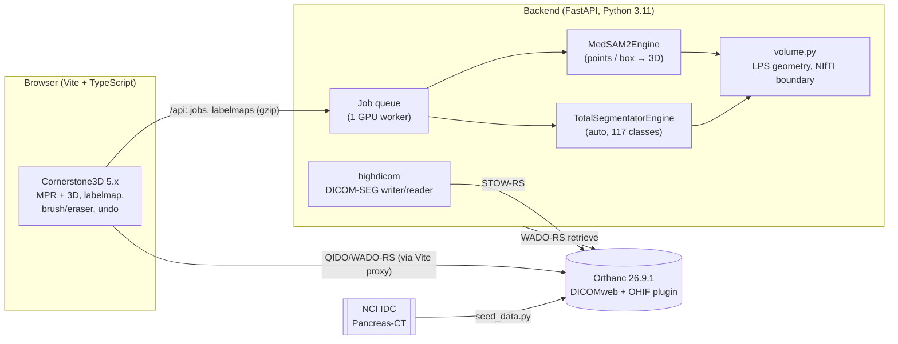
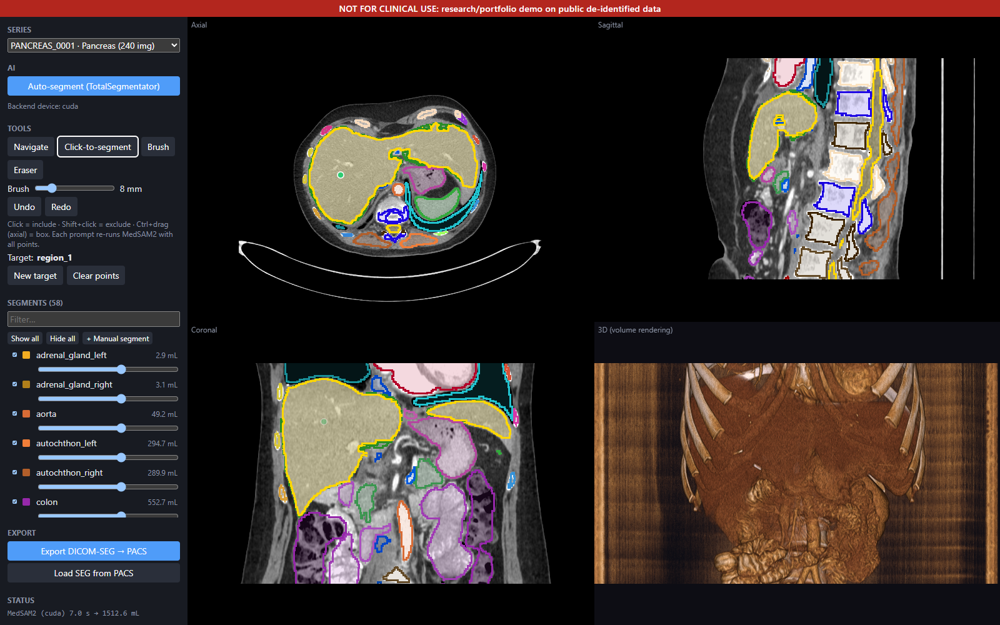

# Promptable 3D CT segmentation demo

## Results

RTX 3070 Laptop 8 GB; PANCREAS_0001 (512×512×240, 0.86×0.86×1.0 mm).

**TotalSegmentator 2.18.0, `total` task**

| Mode | Device | Wall time | Peak VRAM | Liver | Spleen | Pancreas | Pancreas Dice vs. expert |
|---|---|---|---|---|---|---|---|
| full 1.5 mm | CUDA | 80–88 s | 2.6 GiB | 1490 mL | 228 mL | 54 mL | **0.795** |
| fast 3 mm | CUDA | 15–22 s | 2.5 GiB | 1495 mL | 260 mL | 52 mL | 0.763 |
| fast 3 mm | CPU (16 threads) | 36 s | – | 1496 mL | – | – | – |

**MedSAM2 (SAM2.1-tiny), simulated prompts** (`scripts/eval_prompt.py`). Dice vs. the expert SEG
for the pancreas, vs. TotalSegmentator for the rest. 7–9 s per prompt on CUDA, 28 s on CPU
(±25 slices).

| Organ | 1 click | 3 clicks | box | box + click | Pred / ref volume (box) |
|---|---|---|---|---|---|
| Spleen | 0.975 | 0.975 | 0.975 | 0.975 | 231 / 228 mL |
| Kidney (L) | 0.939 | 0.941 | 0.935 | 0.934 | 156 / 139 mL |
| Liver | 0.958 | 0.961 | 0.960 | 0.959 | 1530 / 1490 mL |
| **Pancreas** | 0.496 | 0.579 | 0.665 | 0.637 | 92 / 58 mL |

**DICOM-SEG round trip:** 58 segments exported, stored in Orthanc, reloaded with a 0.00 mL max
per-segment volume change; also opens in OHIF.

Data: TCIA Pancreas-CT (CC BY 3.0), Roth et al. 2016, https://doi.org/10.7937/K9/TCIA.2016.tNB1kqBU.
Not for clinical use.
