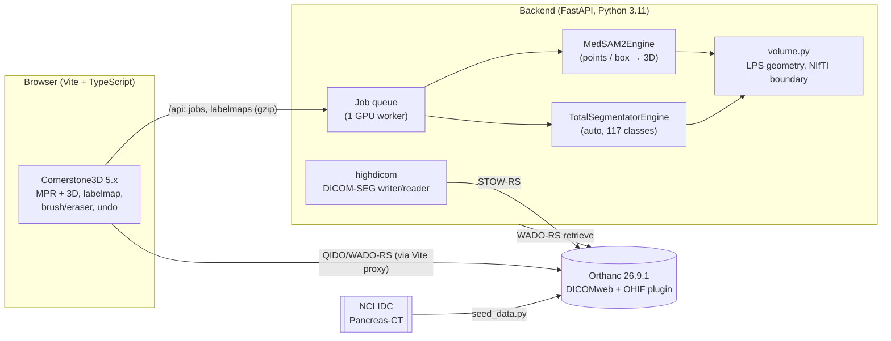

# Promptable 3D CT segmentation demo

> **NOT FOR CLINICAL USE.** Portfolio/research demo on public, de-identified data. No real
> patient data and no cloud upload of images.

An end-to-end modern imaging pipeline on one Windows machine:

**public CT → PACS (Orthanc, DICOMweb) → browser viewer (Cornerstone3D) → AI auto-segmentation
(TotalSegmentator) → click/box-prompted 3D refinement (MedSAM2) → manual brush/eraser
correction with undo → standard DICOM-SEG stored back to the PACS → reloaded and checked.**




## Status, honestly

All milestones run end to end in a real browser (installed Edge, driven by
`frontend/e2e/demo-flow.mjs` through real mouse events; screenshots in `docs/screenshots/`).

| Milestone | State | Evidence (RTX 3070 Laptop) |
|---|---|---|
| 1. Orthanc + data + viewer over DICOMweb | **Done** | 240 slices streamed via WADO-RS in ~2 s; MPR + 3D. |
| 2. TotalSegmentator auto-seg + overlay | **Done** | 80–88 s on GPU, 57 structures; liver 1490 mL, spleen 228 mL; pancreas Dice **0.795** vs. expert SEG; overlay aligned in all three planes (checked by eye). |
| 3. Click-to-segment (MedSAM2) | **Done** | One real click in the liver → 7–8 s → 1512.6 mL, identical to the backend-only run (proves click→world→voxel mapping). Pancreas is weak (see below). |
| 4. Brush/eraser, undo, volume stats | **Done** | Brush 1512.6 → 1513.7 mL, Ctrl+Z → 1512.6 mL exactly (one history for AI + manual edits). |
| 5. DICOM-SEG export → STOW → reload | **Done** | 58 segments / 5073 frames STOWed; reloaded: **max per-segment volume change 0.00 mL**. **Independent check: Orthanc's OHIF opens and renders the SEG** aligned with anatomy (`docs/screenshots/ohif-2-seg.png`). 3D Slicer not tried. |
| 6. Polish | Done, except a GIF | README, scripts, e2e, screenshots. A GIF needs a screen recorder; the screenshots cover the same steps. |

## Quick start (Windows 10/11, PowerShell)

Prerequisites: Docker Desktop (**current version**, WSL2 backend), [uv](https://docs.astral.sh/uv/),
Node 20+, optionally an NVIDIA GPU (driver ≥ 560 for the CUDA 12.6 wheels).

```powershell
.\scripts\dev.ps1 setup      # uv sync (torch cu126, TotalSegmentator, MedSAM2) + npm install
.\scripts\dev.ps1 weights    # MedSAM2 149 MB + TotalSegmentator 1.24 GB -> .\checkpoints
.\scripts\dev.ps1 up         # Orthanc on http://127.0.0.1:8042 (localhost only, no auth)
.\scripts\dev.ps1 seed       # PANCREAS_0001 CT + expert SEG from IDC (128 MB) -> Orthanc
.\scripts\dev.ps1 backend    # http://127.0.0.1:8000  (terminal 2)
.\scripts\dev.ps1 frontend   # http://localhost:5173  (terminal 3)
.\scripts\dev.ps1 check      # ruff + pytest + eslint + tsc + vitest
.\scripts\dev.ps1 eval       # simulated-click MedSAM2 evaluation
npm run e2e --prefix frontend       # full loop in Edge (needs the 3 services up)
npm run e2e:ohif --prefix frontend  # opens the exported SEG in Orthanc's OHIF
```

The e2e scripts use `playwright-core` with the **installed Microsoft Edge and a throwaway
profile** (no browser download, no access to your own browser profile).

No GPU? It falls back automatically (or force it with `$env:SEG_DEVICE = "cpu"`):
TotalSegmentator uses its 3 mm `--fast` model (36 s on a 16-thread laptop CPU) and MedSAM2
propagates over ±25 slices only (28 s per prompt). Details below.

## 2-minute demo script

1. **(0:00) Frame it.** "Public CT from NCI's Imaging Data Commons, stored in Orthanc, a real
   DICOMweb PACS. The viewer streams it with WADO-RS: no files on disk in the browser."
   Pick *PANCREAS_0001* in the series picker; scroll the axial view, show sagittal/coronal/3D.
2. **(0:20) Auto-segment.** Click *Auto-segment*. "TotalSegmentator, nnU-Net, 117 structures.
   ~80 s on this laptop GPU." While it runs: "Orientation is the classic silent failure. This
   dataset has unusual headers (rows point anterior, slices run feet-first); everything goes
   through one explicit LPS geometry module with round-trip tests."
3. **(0:50) Inspect.** Filter the list to *liver*: "1.49 L, plausible." Toggle organs, change
   opacity. "Volumes are computed in the browser from the voxels and spacing, so they update
   when I edit."
4. **(1:05) Prompt.** Choose *Click-to-segment*, click once inside the gallbladder or a kidney.
   "MedSAM2 propagates through the volume in ~9 s." Shift+click on a leak to exclude it; or
   Ctrl+drag a box on the axial view.
5. **(1:30) Correct.** Select the segment, *Brush* / *Eraser* a few voxels, Ctrl+Z / Ctrl+Y.
   "One undo history covers AI writes and manual strokes."
6. **(1:45) Export.** *Export DICOM-SEG → PACS*, then *Load SEG from PACS*: the status shows the
   max per-segment volume change (should be 0.00 mL). "It's a standard object: algorithm type
   per segment (AUTOMATIC vs SEMIAUTOMATIC vs MANUAL), SNOMED codes with laterality, and it
   opens in OHIF at http://127.0.0.1:8042/ohif/ or in 3D Slicer."

## Measured results (RTX 3070 Laptop 8 GB, PANCREAS_0001: 512×512×240, 0.86×0.86×1.0 mm)

**TotalSegmentator 2.18.0, `total` task**

| Mode | Device | Wall time | Peak VRAM | Liver | Spleen | Pancreas | Pancreas Dice vs. expert |
|---|---|---|---|---|---|---|---|
| full 1.5 mm | CUDA | 80–88 s | 2.6 GiB | 1490 mL | 228 mL | 54 mL | **0.795** |
| fast 3 mm | CUDA | 15–22 s | 2.5 GiB | 1495 mL | 260 mL | 52 mL | 0.763 |
| fast 3 mm | CPU (16 threads) | 36 s | – | 1496 mL | – | – | – |

Wall times exclude the one-off weight download and include NIfTI conversion and resampling
back to the CT grid. The backend uses full-res on CUDA and `--fast` on CPU automatically.

**MedSAM2 (MedSAM2_latest, SAM2.1-tiny), simulated prompts** (`scripts/eval_prompt.py`).
Reference = expert SEG for the pancreas, TotalSegmentator full-res for the other organs (so
those numbers measure agreement, not accuracy). ~7–9 s per prompt on CUDA (whole volume).

| Organ | 1 click | 3 clicks | box | box + click | Pred / ref volume (box) |
|---|---|---|---|---|---|
| Spleen | 0.975 | 0.975 | 0.975 | 0.975 | 231 / 228 mL |
| Kidney (L) | 0.939 | 0.941 | 0.935 | 0.934 | 156 / 139 mL |
| Liver | 0.958 | 0.961 | 0.960 | 0.959 | 1530 / 1490 mL |
| **Pancreas** | 0.496 | 0.579 | 0.665 | 0.637 | 92 / 58 mL |

Takeaway: one click is enough for large, well-contrasted organs. For the pancreas MedSAM2 leaks
into neighbouring bowel during propagation; boxes help but over-segment. In the demo that is
what negative clicks and the eraser are for, and it's the honest case for a 3D-native
interactive model (see *What I'd do next*).

**CPU fallback:** MedSAM2 takes 28 s for one click when propagation is limited to ±25 slices
(~0.55 s/slice; the whole 240-slice volume would be ~2 min). The limit means that on CPU, large
organs such as the liver are **cut off 25 slices above/below the click**; click again further
away to extend.

## Stack decisions (and what changed vs. a 2024 mental model)

Versions checked on 2026-10-22.

| Choice | Version | Why / what changed |
|---|---|---|
| **Orthanc** `orthancteam/orthanc` | 26.9.1 | Official image; DICOMweb plugin via env var; bundled **OHIF plugin** gives an independent SEG viewer for free. Bound to 127.0.0.1 because auth is off. |
| **Cornerstone3D** | 5.13.1 | Two majors past 3.x. Viewport-centric segmentation API; **5.x labelmap model separates segment index from label value and supports overlapping layers**; new `@cornerstonejs/metadata` package. The demo `addDicomWebInstance` helper on `main` is *not* in 5.13.1, so the classic `wadors.metaDataManager` path is used. With Vite 8 the production build works out of the box, but **dev mode needed two fixes**: pre-bundle the codecs' CommonJS WASM glue (`optimizeDeps.include`, instead of the docs' CommonJS plugin), and install the `events` polyfill because vtk.js pulls in `xmlbuilder2`, which extends Node's `EventEmitter`. |
| Viewer: Cornerstone3D over Niivue | | Native WADO-RS volume streaming, labelmap brush/eraser with history, same stack as OHIF (so the SEG we write is what OHIF reads). Niivue is lighter and great for NIfTI, but DICOMweb + editable labelmaps + DICOM-SEG would mostly be ours to build. Honest note: the choice was made from the 5.x APIs rather than a side-by-side spike; it held up in practice (two dev-mode bundling fixes, no API dead ends), and OHIF reading our SEG validates the "same ecosystem" argument. |
| **TotalSegmentator** | 2.18.0 | `total` task weights are Apache-2.0; ships a SNOMED-CT mapping CSV (used for SEG codes + colours). **Sends anonymous usage statistics by default** (run metadata, no images): disabled here in code (`send_usage_stats=false`). |
| **MedSAM2** | git `332f30d` (Jul 2025) | Code Apache-2.0, **weights CC-BY-SA-4.0, research/education only**. Repo is inactive since mid-2025; installs on Windows with `SAM2_BUILD_CUDA=0`; the package doesn't ship its Hydra YAML, so the one config is vendored. Trained mostly with **box** prompts, which shows on the pancreas. |
| **highdicom** (not pydicom-seg) | 0.28.2 | Maintained (Oct 2026); pydicom-seg's last release was Feb 2023. BINARY SEG for OHIF/Slicer compatibility (the newer LABELMAP SEG type is supported by highdicom but less widely by viewers). **Found a highdicom quirk on real data:** Pancreas-CT has an *empty* SliceThickness; highdicom copies the source's pixel measures (even over explicitly passed ones), writes them without SliceThickness, and then its own reader rejects the file. Worked around by filling SliceThickness from the measured slice spacing after construction; regression test added. Worth reporting upstream. |
| torch | 2.14.1 + cu126 | Driver 566 supports CUDA ≤ 12.7, so cu126 wheels, not cu128/cu130. |
| TypeScript | **6.0.x, pinned** | TS 7 (Go compiler) is current, but typescript-eslint 8.72 supports TS < 6.1. |

## Orientation: how masks stay aligned

The rule: **one canonical geometry (DICOM LPS, SimpleITK, slices sorted along the normal), and
every boundary crossing is explicit and tested.**

- `backend/app/volume.py`: DICOM read (GDCM IPP sort), `sitk_to_nifti` / `nifti_to_sitk` with
  explicit `diag(-1,-1,1)` LPS↔RAS affines (no library auto-reorientation), and
  `resample_labels_to` that is a pure copy when grids match and nearest-neighbour otherwise
  (e.g. TotalSegmentator handing back a reoriented NIfTI).
- Clicks travel as **world LPS millimetres**, never as voxel indices, so the browser and the
  backend never need to agree on voxel order for prompts.
- Label arrays travel as `(k, j, i)` bytes **plus their geometry**; `frontend/src/geometry.ts`
  matches axes by direction (handles permutations/flips), checks that both grids put voxel 0 at
  the same world point, and **throws instead of drawing a misaligned mask**.
- Tests (`backend/tests`, `frontend/src/geometry.test.ts`): a single asymmetric marker voxel
  through axial (ascending/descending), coronal, 30° oblique, flipped-row and
  Pancreas-CT-like series, NIfTI round-trip, canonical reorientation, DICOM-SEG write→read, and
  reading the expert SEG from IDC onto our grid. Deliberately breaking the RAS flip, the
  array transpose, or the frontend flip offset makes them fail (checked).
- Real data check: the Pancreas-CT headers are unusual (origin 0,0,0; rows point anterior;
  slices feet-wards). Rendering the raw arrays confirmed they match anatomy, and the
  TotalSegmentator pancreas overlaps the independent expert SEG at Dice 0.795.

## Design tradeoffs

- **Server-side inference, not in-browser.** 1.2 GB of nnU-Net weights and a 3D propagation
  model don't belong in a tab; one GPU worker serialises jobs. `@cornerstonejs/ai` (ONNX
  in-browser SAM) exists and is the obvious next experiment for 2D prompts.
- **Job queue in-process** (thread + dict), not Celery/Redis: single user, demo scope.
- **Labelmaps over HTTP as gzipped raw bytes + JSON geometry** (63 MB → 0.64 MB for 57
  organs; prompt results are cropped, ~130 KB). Simpler and more inspectable than NIfTI/SEG
  over the wire; SEG is used where interoperability matters (the PACS).
- **One labelmap, one label per voxel** (TotalSegmentator classes keep their numbers; user
  segments get 200+). Simple, matches BINARY SEG non-overlap; overlapping structures would
  need Cornerstone 5's multi-layer labelmaps.
- **A prompt replaces its target segment** (MedSAM2 is re-run with all points each time), so
  "add a negative click" behaves predictably; brush edits on that segment are overwritten by
  the next prompt (undo restores them).
- **SEG reload via the backend (highdicom)** rather than a second JS SEG parser; OHIF (dcmjs)
  and 3D Slicer (dcmqi/highdicom) serve as the independent readers.
- **Exported codes:** TotalSegmentator classes get their SNOMED codes (incl. laterality
  modifiers); user-named segments get *Anatomical Structure / Tissue*. Algorithm type per
  segment: AUTOMATIC (untouched TotalSegmentator), SEMIAUTOMATIC (edited or MedSAM2), MANUAL.

## Known limitations

- 3D view shows volume rendering only (no segmentation surfaces; needs Cornerstone PolySeg).
  The scanner table and out-of-field region show as a striped band behind the body.
- A prompt **takes over voxels from other labels**: clicking inside the TotalSegmentator liver
  creates `region_1` and empties `liver` (one label per voxel). Intended for refining, but
  surprising if you only wanted a second opinion; undo restores it.
- Exported SliceThickness for Pancreas-CT is *derived* (= slice spacing), because the source
  header is empty.
- MedSAM2 pancreas quality is mediocre (table above); MedSAM2 weights are research-only.
- Box prompt only on the axial view; clicks work on all three MPR views.
- In-memory state: restarting the backend forgets jobs and cached volumes; one volume cached.
- No auth, localhost only; Orthanc has authentication disabled.
- GPU non-determinism: repeated TotalSegmentator runs differ in ~300 of 63M voxels.
- Frontend bundle is 3.6 MB (1 MB gzip); not code-split.

## Data, models and licences

| Item | Source | Licence / terms |
|---|---|---|
| CT: TCIA **Pancreas-CT**, PANCREAS_0001 (240 slices, 126 MB) | NCI Imaging Data Commons (IDC v25), downloaded by `scripts/seed_data.py` | **CC BY 3.0** |
| Reference pancreas DICOM-SEG for PANCREAS_0001 | IDC (same series) | **CC BY 4.0** |
| TotalSegmentator code + `total` weights | github.com/wasserth/TotalSegmentator | Apache-2.0 (some other tasks need a licence; not used) |
| MedSAM2 code | github.com/bowang-lab/MedSAM2 | Apache-2.0 (one config file vendored) |
| MedSAM2 weights `MedSAM2_latest.pt` | huggingface.co/wanglab/MedSAM2 | **CC-BY-SA-4.0, research and education only** |
| Cornerstone3D | cornerstonejs.org | MIT |
| Orthanc | orthanc-server.com | GPLv3 (used as a separate service) |

Imaging data and weights are never committed (`.gitignore`); scripts download them.

**Citations.** Roth HR, Farag A, Turkbey EB, Lu L, Liu J, Summers RM. *Data From Pancreas-CT
(Version 2)*. The Cancer Imaging Archive, 2016. https://doi.org/10.7937/K9/TCIA.2016.tNB1kqBU ·
Fedorov A, et al. *National Cancer Institute Imaging Data Commons*. RadioGraphics 2023. ·
Wasserthal J, et al. *TotalSegmentator: Robust Segmentation of 104 Anatomic Structures in CT
Images*. Radiology: AI 2023. · Ma J, et al. *MedSAM2: Segment Anything in 3D Medical Images and
Videos*. arXiv:2504.03600, 2025. · Herz C, et al. *highdicom*. J Digit Imaging 2022.

## What I'd do next

- **3D-native interactive model**: VISTA3D (MONAI/NVIDIA, point clicks in 3D, NVIDIA Open Model
  Licence) behind the same `PromptSegmentationEngine`, and compare on the pancreas.
- **Text prompts**: BiomedParse ("segment the pancreas") through the existing `text` field.
- **In-browser inference**: ONNX Runtime Web / WebGPU for the 2D prompt encoder
  (`@cornerstonejs/ai`), keeping the server for 3D propagation.
- **MR support**: TotalSegmentator `total_mr`, plus series-type routing.
- **Report drafting**: volumes + findings into a DICOM SR (TID 1500) and an LLM-drafted,
  clinician-editable summary, with provenance links to the SEG.
- **Engineering**: persistent job store, auth on Orthanc (OAuth2 proxy), run the e2e script in
  CI against a GPU-less backend (`--fast`), code-split the viewer bundle, 3D Slicer check.
